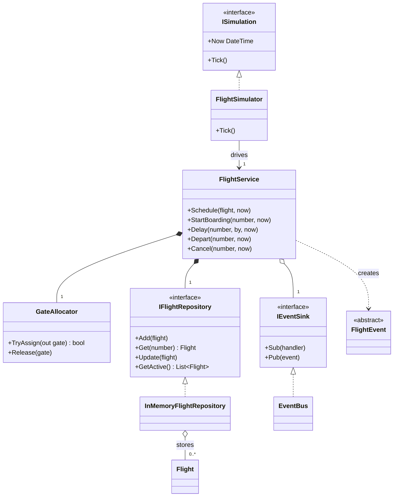
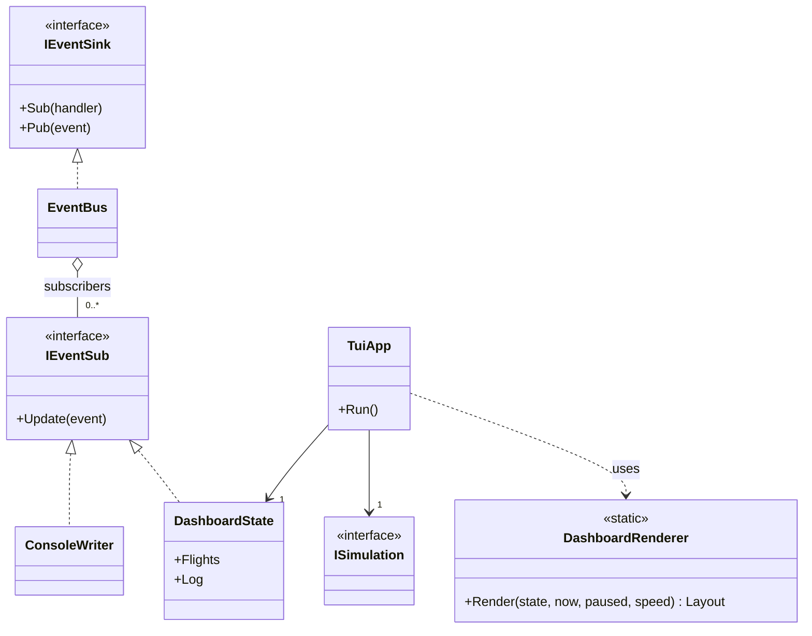
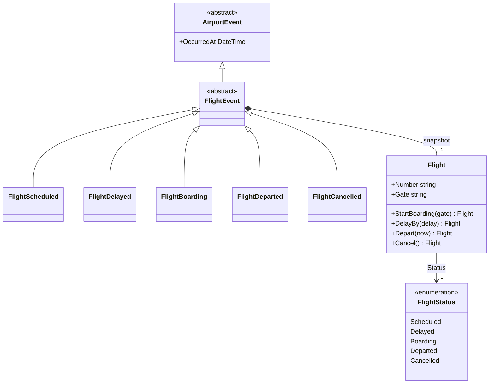

# Laboratory Work Report

---

## 1. Project Overview

The project is a small airport departure-board simulator written in C# (.NET 10). It runs on a
simulated clock where one tick is one simulated minute. On each tick:

- new flights may be scheduled (random airline, destination and departure time);
- a flight that is 40 minutes from departure asks for a free gate and starts **Boarding**, or gets a
  15-minute delay if no gate is free;
- a boarding flight **Departs** when its expected departure time arrives, and its gate is released;
- any flight may randomly be **Delayed**, and a flight delayed for more than 3 hours is **Cancelled**.

Every state change is published as an event. Two front ends listen to these events: a plain console
writer and a live terminal dashboard (`--tui`, built with Spectre.Console).

The code is split into layers:

| Layer | Contents |
|---|---|
| `Domain` | `Flight`, `FlightStatus`, events, and the ports `IFlightRepository`, `IEventSink`, `IEventSub` |
| `Services` | `FlightService` (use cases), `GateAllocator` |
| `Infra` | `InMemoryFlightRepository`, `EventBus` |
| `App` | `FlightSimulator`, `ISimulation`, `Program` (composition root) |
| `UI` | `ConsoleWriter`, `DashboardState`, `DashboardRenderer`, `TuiApp` |

---

## 2. Class Diagrams

To keep them readable, the classes are shown in three small diagrams instead of one large one.
Each diagram shows only the members that matter for the relationships. Private fields, helpers
and the `Program` entry point are left out.

**Notation used**

| Arrow | UML relationship | Meaning in this project |
|---|---|---|
| hollow triangle, solid line | Generalization (inheritance) | `FlightEvent` is an `AirportEvent` |
| hollow triangle, dashed line | Realization (implements) | `EventBus` implements `IEventSink` |
| filled diamond | Composition | The whole owns the part on its own. The part is not shared and does not exist without the whole |
| hollow diamond | Aggregation | The whole holds parts that are shared or live on their own |
| solid line, open arrow | Association | A long-lived reference to a collaborator |
| dashed line, open arrow | Dependency | Short-term use only: creates it, receives it as a parameter, or calls a static method |

The numbers at the line ends are multiplicities (`1` means exactly one, `0..*` means any number).

### 2.1 Simulation and use cases



- `FlightService` **composes** `GateAllocator` and the flight repository. `Program` creates both
  only to pass them to the service, and nothing else uses them, so they live and die with it.
- `FlightService` **aggregates** the event sink. The same `EventBus` is shared with `Program`, which
  uses it to register the UI subscribers, so the service does not own it.
- `FlightSimulator` only **drives** the service (a plain association), and the service **depends**
  on the event classes because it creates a new event for every transition.

### 2.2 Events and their subscribers (Observer)



`EventBus` **aggregates** its subscribers. They are created in `Program` and live on their own, so
the bus only keeps references to them. `TuiApp` only needs `ISimulation`, not the concrete
simulator, and calls the static `DashboardRenderer` on every redraw (a dependency).

### 2.3 Domain model



`Flight` is an immutable record, and every transition returns a new copy. Each event therefore
**composes** the snapshot of the flight at the moment the event happened, so the snapshot belongs
to that event.

**How it fits together:** `FlightSimulator` advances the clock and decides *what* should happen.
`FlightService` carries out each change in the same four steps: load the flight, apply the
transition on `Flight`, save it in the repository, and publish an event. `EventBus` forwards that
event to every subscriber, so the console and the dashboard update without the service knowing
they exist.

---

## 3. SOLID Principles in the Project

### 3.1 Single Responsibility Principle (SRP)

> A class should have only one reason to change.

Each class in the project does one job:

| Class | Its only responsibility |
|---|---|
| `Flight` | Enforcing its own lifecycle rules (which status changes are allowed) |
| `GateAllocator` | Tracking which gates are free |
| `InMemoryFlightRepository` | Storing and querying flights |
| `EventBus` | Delivering events to subscribers |
| `FlightService` | Coordinating a use case: load → transition → save → publish |
| `FlightSimulator` | Simulation rules: time, randomness, when things happen |
| `DashboardState` | Keeping the dashboard's view of flights and the event log |
| `DashboardRenderer` | Drawing that state with Spectre.Console |
| `TuiApp` | The loop: keyboard input, pause/speed, redraw |

**Example 1: gates have their own class.** Gate bookkeeping is not mixed into `FlightService`. It
lives in `GateAllocator`, which only hands out and takes back gates:

```csharp
public class GateAllocator(List<string> startingGates)
{
    private readonly SortedSet<string> _availableGates = new(startingGates);

    public bool TryAssign([NotNullWhen(true)] out string? gate) { ... }
    public void Release(string gate) => _availableGates.Add(gate);
}
```

If the gate policy changed (for example, preferred gates per airline), only this class would change.

**Example 2: state and rendering are separate.** In the TUI, `DashboardState` only collects data
from events, and `DashboardRenderer` only turns that data into a `Layout`. Changing colours or
columns touches the renderer. Changing how long a departed flight stays on the board touches the
state. Neither change affects the other class.

**Example 3: the flight protects its own rules.** Whether a transition is legal is decided inside
`Flight`, not in the service or the simulator:

```csharp
public Flight Depart(DateTime now)
{
    if (Status != FlightStatus.Boarding)
        throw new InvalidOperationException($"{this} cannot depart while {Status}");

    return this with { ActualDepartureTime = now, Status = FlightStatus.Departed };
}
```

---

### 3.2 Open/Closed Principle (OCP)

> Software entities should be open for extension but closed for modification.

**Example 1: new event listeners.** `FlightService` publishes events through `IEventSink`, and
anything that implements `IEventSub` can listen. The project already has two listeners
(`ConsoleWriter` and `DashboardState`). A new one, such as a file logger or a statistics counter,
is a new class plus one line in `Program`:

```csharp
public class FileLogger : IEventSub
{
    public void Update(AirportEvent e) => File.AppendAllText("events.log", $"{e}\n");
}

// Program.cs
eventBus.Sub(new FileLogger());
```

`FlightService`, `EventBus` and the existing subscribers stay unchanged.

**Example 2: the event hierarchy.** Every flight event derives from `FlightEvent`. `DashboardState`
updates the board from the base type, so it does not need a new branch for each kind of event:

```csharp
if (e is FlightEvent flightEvent)
{
    var flight = flightEvent.Flight;
    _flights[flight.Number] = flight;
    ...
}
```

A new event such as `FlightGateChanged : FlightEvent` would update the board without any change to
this code.

**Example 3: new storage.** `FlightService` only knows `IFlightRepository`. To store flights in a
file or a database, you add a new implementation of the interface. The service does not change.

---

### 3.3 Dependency Inversion Principle (DIP)

> High-level modules should not depend on low-level modules; both should depend on abstractions.

**Example 1: `FlightService` depends on ports.** The service holds the business logic and is a
high-level module. It does not create its storage or its event bus, and it does not refer to their
concrete types. It receives abstractions that are defined in the `Domain/Ports` folder:

```csharp
public class FlightService(IFlightRepository repo, GateAllocator gates, IEventSink eventSink)
```

The low-level `Infra` classes (`InMemoryFlightRepository` and `EventBus`) implement those
interfaces. The dependency arrows point from `Infra` toward `Domain`, not from `Services` toward
`Infra`.

**Example 2: `TuiApp` depends on `ISimulation`.** The TUI loop only needs the current time and a
way to move it forward, so it depends on a two-member interface instead of `FlightSimulator`:

```csharp
public interface ISimulation
{
    DateTime Now { get; }
    void Tick();
}

public class TuiApp(ISimulation simulation, DashboardState state)
```

Any other simulation, such as a scripted one for a demo or a test, could be passed in.

**Example 3: one composition root.** All concrete classes are created and connected in one place,
`Program.Main`. Every other class receives its dependencies through its constructor:

```csharp
var eventBus = new EventBus();
var flightService = new FlightService(
    new InMemoryFlightRepository(), new GateAllocator(["A1", "A2"]), eventBus);
var flightSim = new FlightSimulator(flightService, new Random(42), DateTime.Today.AddHours(6));
```

Even the `Random` instance is injected, so a fixed seed makes a run repeatable.

**Possible improvement:** `FlightService` still depends on the concrete `GateAllocator`. Adding an
`IGateAllocator` interface would make the service fully independent of how gates are managed.

---

## 4. Conclusion

In this laboratory work I built an airport departure-board simulator and applied three SOLID
principles. SRP keeps each class small, with one reason to change. OCP, through the observer-style
`IEventSink` / `IEventSub` and the `FlightEvent` hierarchy, lets me add new front ends and new
events without editing existing code. DIP keeps the core logic independent of storage, messaging
and UI details, because it depends only on interfaces and receives its dependencies from a single
composition root. As a result, the console mode and the TUI mode share the same core logic, and
the only difference between them is which subscriber `Program` registers.
