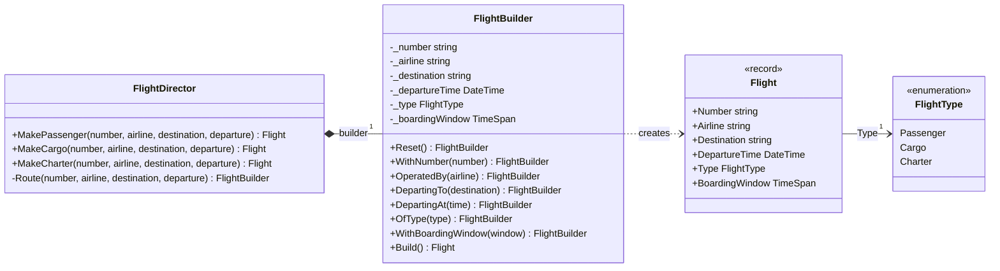
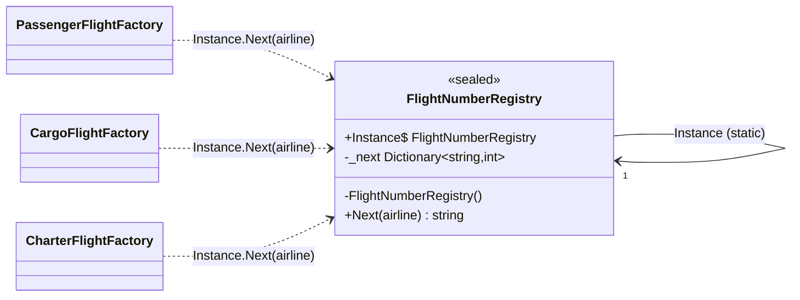
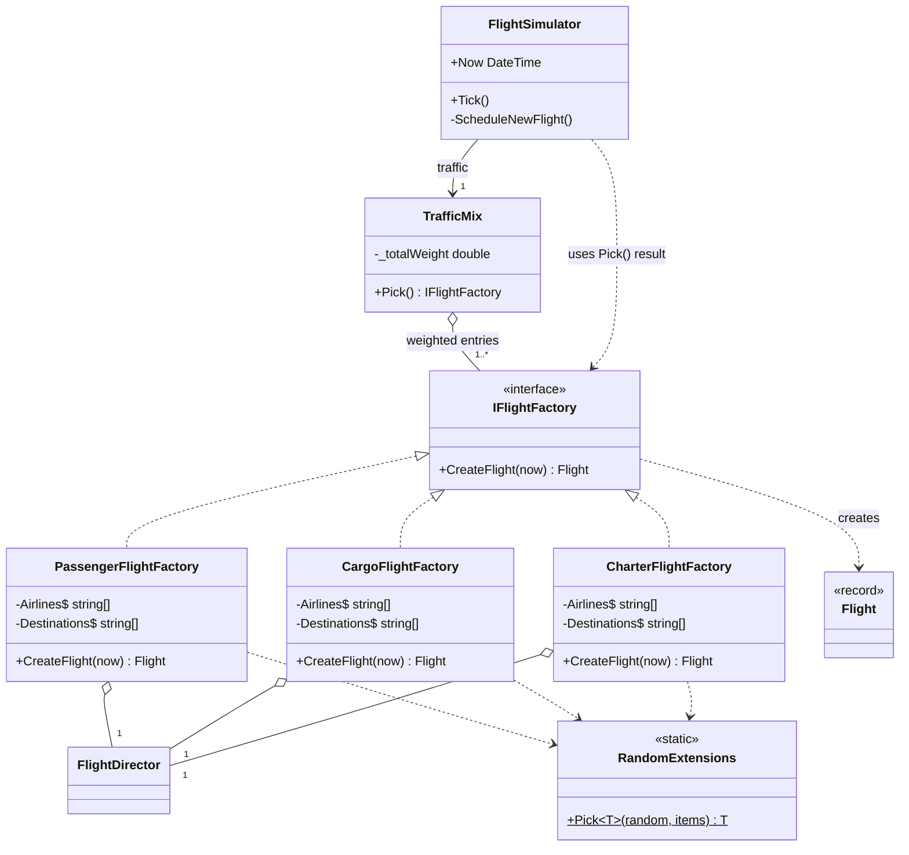

# Laboratory Work Report — Creational Design Patterns

---

## 1. Project Overview

This lab continues the airport departure-board simulator from Lab 1 (C#, .NET 10). The simulator
runs on a simulated clock where one tick is one simulated minute. On each tick new flights may be
scheduled, flights close to departure ask for a gate and start **Boarding**, boarding flights
**Depart**, and any flight may be **Delayed** or **Cancelled**. Every change is published as an
event, and the terminal dashboard (built with Spectre.Console) listens to those events.

The goal of this lab was to refactor the project and add new features so that it uses
**creational design patterns**. I implemented three of them:

| Pattern | Where | Problem it solves |
|---|---|---|
| **Builder** (with a Director) | `Domain/FlightBuilder.cs`, `Domain/FlightDirector.cs` | `Flight` has a long positional constructor and nothing checked its values |
| **Singleton** | `Infra/FlightNumberRegistry.cs` | Flight numbers must stay unique once several factories create flights |
| **Factory Method** | `Domain/Ports/IFlightFactory.cs`, `Infra/Traffic/*FlightFactory.cs` | New feature: three kinds of flights, and the simulator should not know how each one is made |

The new classes follow the layers from Lab 1. Ports (interfaces) live in `Domain/Ports`, and
their implementations live in `Infra`:

| Layer | New or changed classes |
|---|---|
| `Domain` | `FlightType`, `FlightBuilder`, `FlightDirector`, `Flight` (changed) |
| `Domain/Ports` | `IFlightFactory` |
| `Infra` | `FlightNumberRegistry` |
| `Infra/Traffic` | `PassengerFlightFactory`, `CargoFlightFactory`, `CharterFlightFactory`, `TrafficMix`, `RandomExtensions` |
| `App` | `FlightSimulator` and `Program` (changed) |
| `UI` | `DashboardRenderer` (changed: Type column) |

**New feature: flight types.** The airport now handles three kinds of flights. Each kind has its
own airlines, destinations, scheduling lead time and boarding window:

| Type | Airlines | Destinations | Scheduled ahead | Boarding window |
|---|---|---|---|---|
| Passenger | TK, PC, LH, W6 | LHR, CDG, FRA, AMS, FCO, MAD, VIE, ATH | 60–180 min | 40 min |
| Cargo | CV, 5X | LEJ, CGN, LGG | 120–300 min | 20 min |
| Charter | XQ, BJ | AYT, HRG, PMI | 90–240 min | 60 min |

To support this, `Flight` got two new fields, `Type` (a new `FlightType` enum) and
`BoardingWindow`. The simulator no longer has a fixed 40-minute constant. It reads the boarding
window from each flight:

```csharp
if (Now >= flight.ExpectedDepartureTime - flight.BoardingWindow)
{
    fs.StartBoarding(flight.Number, Now);
    return;
}
```

**Other changes in this lab**

- The terminal dashboard is now the default (and only) front end. `Program` starts it directly,
  without the `--tui` flag, and the console mode was removed from `Main`.
- The dashboard got a **Type** column (cargo is shown in orange, charter in aqua), and the
  "scheduled" log line includes the flight type.
- The old `FlightSimulator.Run()` method was dead code, an empty loop. I removed it.
- I fixed a bug that was already in Lab 1. In `FlightSimulator.Advance`, a flight could start
  boarding and then get a random delay in the same tick, which threw `cannot be delayed while
  Boarding`. A `return` after `StartBoarding` fixes it.

---

## 2. Builder (with a Director)

### 2.1 What the pattern is

The **Builder** pattern moves the construction of a complex object into a separate object. That
object sets the parts step by step through readable methods, then returns the finished product
with a single `Build()` call. `Build()` is also the one place where the object is checked, so a
half-built or invalid object can never escape.

The optional **Director** sits on top of the builder. It knows the *recipes*: which builder steps
to call, and with which fixed values, to produce a particular variant of the product. The builder
knows **how** to set each part. The director knows **which** parts a given variant needs.

### 2.2 Why it fits here

`Flight` is a record with positional parameters only (eight before this lab, ten now), and several
of them share a type. `Number`, `Airline` and `Destination` are all `string`s, and `Delay` and
`BoardingWindow` are both `TimeSpan`s. Before this lab, `FlightSimulator` created flights like
this:

```csharp
var flight = new Flight(
    $"{airline}{number}",
    airline,
    Destinations[random.Next(Destinations.Length)],
    Now.AddMinutes(random.Next(60, 181)),
    FlightStatus.Scheduled,
    TimeSpan.Zero);
```

Swapping `airline` and the destination would still compile, and nothing checked the values. With
the new flight types the problem grows: every place that creates a cargo flight would also have to
remember its type and its 20-minute boarding window.

### 2.3 Class diagram



- `FlightDirector` **composes** its `FlightBuilder`. `Program` creates the builder only to pass it
  to the director (`new FlightDirector(new FlightBuilder())`), and nothing else uses it.
- `FlightBuilder` **depends** on `Flight` because it creates it in `Build()`. The builder is the
  only class that calls the `Flight` constructor.

### 2.4 Implementation

Every setter returns `this`, so calls chain into one readable expression (a *fluent interface*).
`Reset()` puts every field back to its default, so one builder instance can be reused for many
flights:

```csharp
public FlightBuilder OfType(FlightType type)
{
    _type = type;
    return this;
}

public FlightBuilder Reset()
{
    _number = null;
    _airline = null;
    _destination = null;
    _departureTime = null;
    _type = FlightType.Passenger;
    _boardingWindow = DefaultBoardingWindow;
    return this;
}
```

`Build()` checks the collected values before it creates the record. For example, a flight number
must start with its airline code:

```csharp
if (string.IsNullOrWhiteSpace(_number) || !_number.StartsWith(_airline))
{
    throw new InvalidOperationException($"Flight number '{_number}' must start with airline code {_airline}");
}
...
return new Flight(
    _number,
    _airline,
    _destination,
    _departureTime.Value,
    FlightStatus.Scheduled,
    TimeSpan.Zero,
    _type,
    _boardingWindow);
```

The director holds one recipe per flight type. The steps that are the same for every type (number,
airline, destination, departure) live in a private helper. Each recipe adds only what makes its
type different:

```csharp
public class FlightDirector(FlightBuilder builder)
{
    public Flight MakeCargo(string number, string airline, string destination, DateTime departure)
    {
        return Route(number, airline, destination, departure)
            .OfType(FlightType.Cargo)
            .WithBoardingWindow(TimeSpan.FromMinutes(20))
            .Build();
    }

    private FlightBuilder Route(string number, string airline, string destination, DateTime departure)
    {
        return builder.Reset()
            .WithNumber(number)
            .OperatedBy(airline)
            .DepartingTo(destination)
            .DepartingAt(departure);
    }
}
```

---

## 3. Singleton

### 3.1 What the pattern is

The **Singleton** pattern makes sure a class has **exactly one instance** and gives a single global
access point to it. The constructor is private, so no other code can call `new`, and the one
instance is exposed through a static property.

### 3.2 Why it fits here

In Lab 1, `FlightSimulator` kept a private `Dictionary<string, int>` with the next number for each
airline. In this lab, flights are created by three separate factories (section 4). If each factory
kept its own counter, two of them could produce the same number. `FlightService.Schedule` throws
when a flight number already exists, so a duplicate would crash the simulation:

```csharp
if (f != null)
{
    throw new Exception($"Flight {flight.Number} already exists");
}
```

A single registry that every factory shares makes flight numbers unique across the whole
application.

### 3.3 Class diagram



The underlined `Instance` is a **static** member, and the self-association shows that the class
holds its own only instance. The constructor is marked `-`, which means private. Factories never
store the registry. They read `FlightNumberRegistry.Instance` whenever they need a number, which is
a dependency.

### 3.4 Implementation

```csharp
public sealed class FlightNumberRegistry
{
    private const int FirstNumber = 100;

    public static FlightNumberRegistry Instance { get; } = new();

    private readonly Dictionary<string, int> _next = new();

    private FlightNumberRegistry()
    {
    }

    public string Next(string airline)
    {
        var number = _next.GetValueOrDefault(airline, FirstNumber);
        _next[airline] = number + 1;
        return $"{airline}{number}";
    }
}
```

Every factory asks the one instance for a number at the moment it creates a flight:

```csharp
return director.MakeCargo(FlightNumberRegistry.Instance.Next(airline), airline, random.Pick(Destinations),
    now.AddMinutes(random.Next(120, 301)));
```

---

## 4. Factory Method

### 4.1 What the pattern is

The **Factory Method** pattern declares a method for *creating* an object in a **creator** type,
and lets each **concrete creator** decide which object is made and how. Client code works only
with the creator type, so a new variant means a new concrete creator, and the client does not
change.

The creator can be an abstract base class or an interface. In this project it is an interface,
`IFlightFactory`, with a single factory method. Each concrete factory implements it.

### 4.2 Why it fits here

The new feature adds three kinds of flights. Each kind has different airlines, destinations and
lead times, and needs a different director recipe. Without the pattern, `FlightSimulator` would
contain a `switch` over the flight type and all three sets of data. With the pattern, each kind of
flight has its own factory class, and the simulator only knows `IFlightFactory`. The concrete
factories are named in one place, the composition root (`Program`).

### 4.3 Class diagram



- `CreateFlight(now)` on `IFlightFactory` is the **factory method**. The three factories
  **realize** the interface (dashed line, hollow triangle). None of them inherits from another.
- All three factories **aggregate** the same `FlightDirector`, which is shared, not owned.
- The `Pick` helper they share is a static extension method on `Random`, so the factories only
  **depend** on it.
- `TrafficMix` **aggregates** the factories together with their weights, but it only knows them as
  `IFlightFactory`. `FlightSimulator` keeps a reference to the mix (an association) and only
  *uses* the factory it returns (a dependency), so it never sees a concrete factory class.

### 4.4 Implementation

The creator is a port in `Domain/Ports`, next to `IFlightRepository` and `IEventSink`:

```csharp
public interface IFlightFactory
{
    Flight CreateFlight(DateTime now);
}
```

Each concrete creator lives in `Infra/Traffic`. It receives what it needs through its constructor,
chooses the random data for its kind of flight, takes a number from the registry (Singleton) and
passes everything to the matching director recipe (Builder):

```csharp
public class CargoFlightFactory(Random random, FlightDirector director) : IFlightFactory
{
    private static readonly string[] Airlines = ["CV", "5X"];
    private static readonly string[] Destinations = ["LEJ", "CGN", "LGG"];

    public Flight CreateFlight(DateTime now)
    {
        var airline = random.Pick(Airlines);
        return director.MakeCargo(FlightNumberRegistry.Instance.Next(airline), airline, random.Pick(Destinations),
            now.AddMinutes(random.Next(120, 301)));
    }
}
```

`PassengerFlightFactory` and `CharterFlightFactory` have the same shape, with their own data and
`MakePassenger` / `MakeCharter`. The one helper they share, picking a random element from an
array, is an extension method instead of an inherited member:

```csharp
public static class RandomExtensions
{
    public static T Pick<T>(this Random random, T[] items) => items[random.Next(items.Length)];
}
```

### 4.5 Choosing a factory

The Factory Method pattern does not say *how* a concrete creator is chosen. It only says the
client works with the creator type. I gave that job to a separate small class, `TrafficMix`,
which picks a factory at random according to a weight:

```csharp
public IFlightFactory Pick()
{
    var roll = _random.NextDouble() * _totalWeight;
    foreach (var (factory, weight) in _entries)
    {
        roll -= weight;
        if (roll < 0)
        {
            return factory;
        }
    }

    // Only reachable through floating point rounding; fall back to the last weighted entry.
    return _entries.Last(e => e.Weight > 0).Factory;
}
```

The constructor rejects negative weights, and it rejects a mix whose weights add up to zero.

The responsibilities are split between three places:

1. **`Program`** (the composition root) decides *which* factories exist and *how often* each is
   used:

    ```csharp
    var random = new Random((int)DateTime.Now.ToBinary());
    var director = new FlightDirector(new FlightBuilder());
    var traffic = new TrafficMix(random, [
        (new PassengerFlightFactory(random, director), 0.7),
        (new CargoFlightFactory(random, director), 0.15),
        (new CharterFlightFactory(random, director), 0.15),
    ]);
    var flightSim = new FlightSimulator(flightService, random, DateTime.Today.AddHours(6), traffic);
    ```

2. **`TrafficMix`** decides *which factory this time*, and returns it as `IFlightFactory`.
3. **`FlightSimulator`** only *uses* the factory it gets back:

    ```csharp
    private void ScheduleNewFlight()
    {
        var flight = traffic
            .Pick()
            .CreateFlight(Now);
        fs.Schedule(flight, Now);
    }
    ```

The airline and destination lists and the number counter all moved out of `FlightSimulator`. The
lists now live in the factories, and the counter lives in the registry.

---

## 5. Conclusion

In this laboratory work I extended the airport simulator with passenger, cargo and charter flights
and used three creational patterns to support the feature. The **Builder** with a **Director**
replaced a long and unchecked positional constructor with readable, validated construction, and
keeps the fixed rules of each flight type in one place. The **Singleton** gives the whole
application a single source of unique flight numbers. That became necessary as soon as more than
one class could create flights. The **Factory Method** lets each kind of flight decide how it is
created, through the `IFlightFactory` port, while the simulator works only with that interface and
a weighted `TrafficMix`. Together the patterns removed all flight-creation details from `FlightSimulator`,
so a new kind of flight can be added without changing the simulation code.
